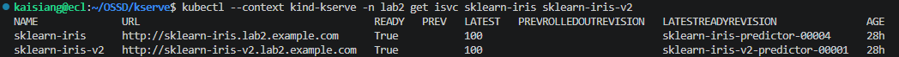
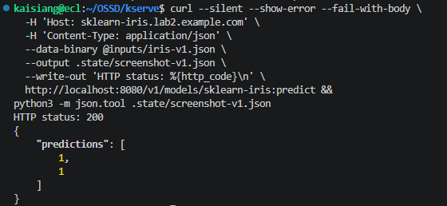
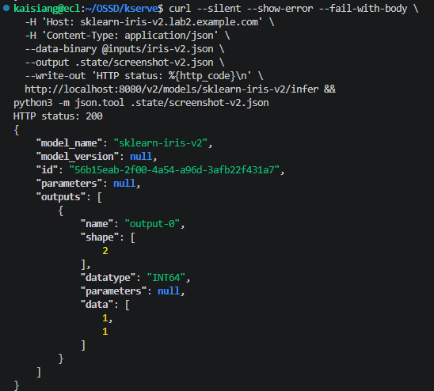
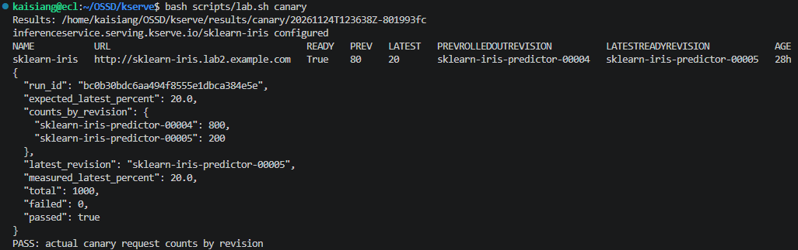
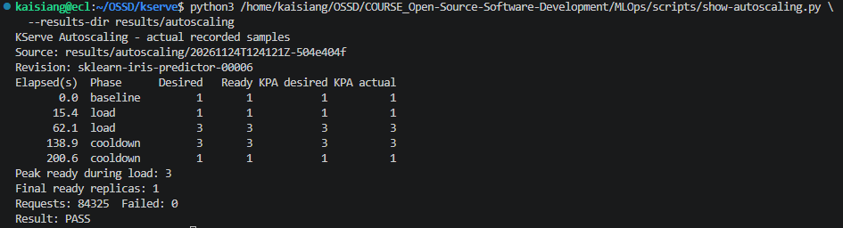

# MLOps Lab 2：Serving Models with KServe

課程：開源軟體開發。

本實驗在 Ubuntu 主機上以 rootless Podman 執行 kind Kubernetes cluster，部署 KServe、Knative Serving 與 Istio，驗證 Iris 模型的 HTTP 推論、Canary 升版與自動擴縮容。

## 1. 作業內容與檔案位置

### Deployment & Test Files

| 作業要求 | 對應檔案 | 說明 |
| --- | --- | --- |
| KServe InferenceService YAML | [iris-v1.yaml](manifests/inference/iris-v1.yaml)、[iris-v2.yaml](manifests/inference/iris-v2.yaml) | 相同模型分別使用 V1、V2 Protocol |
| Canary Deployment YAML | [20-percent.yaml](manifests/canary/20-percent.yaml)、[promote.yaml](manifests/canary/promote.yaml) | 新版 20% 分流，再提升至 100% |
| Autoscaling YAML | [iris.yaml](manifests/autoscaling/iris.yaml) | Knative KPA，以 concurrency 為指標，副本數範圍為 1–3 |
| 模型推論指令與腳本 | [lab.sh](scripts/lab.sh)、[lab.py](scripts/lab.py)、[V1 input](inputs/iris-v1.json)、[V2 input](inputs/iris-v2.json) | `inference` 子命令部署服務並驗證兩種協定 |
| 負載測試腳本與輸入 | [traffic.py](scripts/traffic.py)、[負載輸入](results/submitted/autoscaling/load-input.json) | 限定測試時間及並行數，記錄每筆 HTTP 結果 |
| 模型產生與儲存設定 | [train.py](models/train.py)、[job.yaml](manifests/models/job.yaml)、[pvc.yaml](manifests/models/pvc.yaml) | 使用相同 serving image 訓練模型並存入 PVC |
| 環境建置設定 | [environment/](environment/)、[SETUP.md](docs/SETUP.md) | 固定版本、kind 設定、安裝步驟及問題排除 |
| Bonus 1：LLM Serving | [部署設定](manifests/llm/qwen-05b.yaml)、[請求 JSON](inputs/qwen-chat.json)、[操作說明](docs/LLM.md) | Qwen2.5-0.5B-Instruct 跨機推論 |

### Screenshots 與原始結果

| 驗收項目 | 原始資料 | 執行截圖 |
| --- | --- | --- |
| InferenceService READY=True | [V1 服務狀態](results/submitted/inference/sklearn-iris.json)、[V2 服務狀態](results/submitted/inference/sklearn-iris-v2.json) | [01-ready.png](screenshots/01-ready.png) |
| V1 Protocol 預測 | [自動測試回應](results/submitted/inference/v1-response.json)、[截圖呼叫回應](results/submitted/inference/screenshot-v1-response.json) | [02-inference-v1.png](screenshots/02-inference-v1.png) |
| V2 Protocol 預測 | [自動測試回應](results/submitted/inference/v2-response.json)、[截圖呼叫回應](results/submitted/inference/screenshot-v2-response.json) | [03-inference-v2.png](screenshots/03-inference-v2.png) |
| Canary 各版本請求數 | [summary.json](results/submitted/canary/summary.json)、[requests.csv](results/submitted/canary/requests.csv)、[revision 日誌](results/submitted/canary/) | [04-canary-counts.png](screenshots/04-canary-counts.png) |
| 負載期間副本數變化 | [replicas.csv](results/submitted/autoscaling/replicas.csv)、[summary.json](results/submitted/autoscaling/summary.json) | [05-autoscaling.png](screenshots/05-autoscaling.png) |

## 2. 系統架構與模型

```text
Ubuntu → rootless Podman → kind 節點容器 → Kubernetes / containerd
  ├─ KServe：管理 InferenceService 與 serving runtime
  ├─ Knative Serving：管理 revision、流量分配與 KPA 擴縮容
  ├─ Istio：提供 HTTP ingress 與路由
  ├─ Job：訓練 Iris 模型，將模型檔案寫入 PVC
  └─ 推論 Pod：queue-proxy + sklearnserver

HTTP client → localhost:8080 port-forward → Istio
            → Knative 路由／必要時 Activator → queue-proxy → model.predict()
```

Iris 以萼片長度、萼片寬度、花瓣長度及花瓣寬度分類花卉品種，標籤為 `0=setosa`、`1=versicolor`、`2=virginica`。
Kubernetes Job 使用 sklearn 1.5.2 訓練 RBF SVC：模型 v1 設定 `C=1`，模型 v2 設定 `C=10`，訓練設定與輸出收錄於 [models.log](results/submitted/models/models.log)。
訓練與推論使用相同 serving image，模型透過 PVC 提供給推論 Pod。實驗未切分訓練集與測試集，驗證範圍為模型部署及服務行為，不涵蓋泛化能力比較。

`sklearn-iris` 使用 V1 Protocol，`sklearn-iris-v2` 使用 V2 Protocol；協定測試階段均載入模型 v1，對相同輸入回傳 `[1, 1]`。
模型 v1／v2 表示模型檔案版本，V1／V2 Protocol 表示 API 格式，Knative revision 表示服務設定版本。模型更新或擴縮容設定變更皆可能建立新 revision。

部署採 Knative／Serverless 模式，對應講義第 50 頁的 revision 與 `canaryTrafficPercent` 流程。

## 3. 實測結果

| 實驗 | 結果 | 狀態 |
| --- | --- | --- |
| 環境與 ingress | HTTP 回傳 `lab2-environment-ok` | PASS |
| InferenceService | 兩個服務皆為 READY=True | PASS |
| V1 推論 | HTTP 200，`predictions: [1, 1]` | PASS |
| V2 推論 | HTTP 200，`outputs[0].data: [1, 1]` | PASS |
| Canary 80／20 | 舊 revision 800 次、新 revision 200 次，零失敗 | PASS |
| Promote | 100 次請求全數進入新版，零失敗 | PASS |
| Autoscaling | Ready replicas `1 → 3 → 1`；84,325 次請求，零失敗 | PASS |
| Bonus 1：LLM 跨機推論 | 第二台電腦透過主機 IP 呼叫 Chat Completion，回傳 HTTP 200 與生成文字 | PASS |

Canary 以 run ID、request sequence 與 queue-proxy revision 日誌逐筆核對請求歸屬。
Autoscaling 使用 16 個並行 worker，負載持續 120 秒，每筆請求包含 256 筆 Iris 資料；每 5 秒記錄 Deployment 與 KPA 的副本狀態。
模型服務採用 Knative KPA 的 concurrency 指標；metrics-server 提供系統 CPU／記憶體指標。
完整資料格式與檔案位置見 [實測結果索引](results/README.md)。

### InferenceService 就緒狀態



### V1 Protocol 推論



### V2 Protocol 推論



### Canary 分流統計



### Autoscaling 副本變化



[副本數曲線](results/submitted/autoscaling/replicas.png)由同一輪 [replicas.csv](results/submitted/autoscaling/replicas.csv) 繪製，呈現負載開始、擴容及冷卻縮容的完整時序。

### Bonus 1：LLM Serving

KServe 以自訂 predictor 容器部署 llama.cpp 的 `llama-server`，載入 Qwen2.5-0.5B-Instruct Q4_K_M GGUF 模型。服務採單副本，模型容器的 CPU request 與 limit 均為 4，prompt 處理與 token 生成各設定 4 個執行緒。

KServe 部署於 x86_64 Ubuntu 主機，目前版本為 Ubuntu 26.04。Windows 測試端在 WSL Ubuntu 20.04 中執行 `curl`，透過主機 IP 的 `18080` 連接埠呼叫 `/openai/v1/chat/completions`。Istio 依 `Host` header 將請求轉送至 `qwen-05b`。服務回傳 HTTP 200 並生成 70 個 token，`finish_reason` 為 `stop`。 [部署與跨機操作](docs/LLM.md) · [回應摘要](results/submitted/llm/chat-response-summary.json)

## 4. 重現方式

環境前提、建置步驟與 Troubleshooting 收錄於 [SETUP.md](docs/SETUP.md)。以下指令於 `MLOps/` 目錄執行。

### 環境恢復與協定驗證

```bash
bash scripts/lab.sh resume &&
bash scripts/lab.sh models &&
bash scripts/lab.sh inference
```

### Canary 分流

```bash
bash scripts/lab.sh canary
```

### 升版與負載測試

Canary 結果及截圖保存後，執行升版與負載測試：

```bash
bash scripts/lab.sh promote &&
bash scripts/lab.sh autoscale
```

階段間以 PASS 作為繼續條件；FAIL 時保留結果供除錯。
`inference` 會將主服務恢復為模型 v1 baseline，各階段須依序執行，避免同時操作相同服務。
新執行結果寫入 `results/<stage>/<run>/`，已驗證的結果保留於 `results/submitted/`。

### 手動推論

完成環境與模型部署後，可使用下列 HTTP 呼叫：

```bash
source scripts/env.sh
curl --fail \
  -H 'Host: sklearn-iris.lab2.example.com' \
  -H 'Content-Type: application/json' \
  --data-binary @inputs/iris-v1.json \
  http://localhost:8080/v1/models/sklearn-iris:predict

curl --fail \
  -H 'Host: sklearn-iris-v2.lab2.example.com' \
  -H 'Content-Type: application/json' \
  --data-binary @inputs/iris-v2.json \
  http://localhost:8080/v2/models/sklearn-iris-v2/infer
```

## 5. 驗證範圍與限制

離線測試使用暫時的 loopback HTTP fixture 與模擬命令，不操作 Kubernetes：

```bash
python3 -m unittest discover -s tests -v
```

測試涵蓋 HTTP 請求識別、錯誤與逾時、負載期限、opener 重用、revision 計數、部署狀態等待、webhook 就緒探測及目錄搬移後的 ingress 服務處理。
離線測試與 cluster 實測分別記錄；部署結果以原始測試資料與截圖為依據。

環境為本機單節點 cluster，未驗證多節點高可用性。Podman、Kubernetes 與負載工具共用主機資源；模型儲存於節點內的 PVC，刪除 cluster 將一併移除節點內實驗資料。
工具二進位、kubeconfig、憑證及課堂簡報不列入提交內容。
