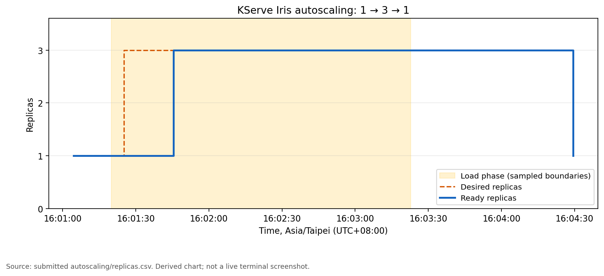

# MLOps Lab 2：Serving Models with KServe

課程：開源軟體開發。

本作業在 Ubuntu 主機上，使用 rootless Podman 執行 kind Kubernetes cluster，部署 KServe／Knative／Istio，完成 Iris 模型的 HTTP 推論、Canary 升版與負載下的自動擴縮容。

**目前狀態：主要功能已實測通過，執行結果截圖待補齊。**

## 1. 作業內容與檔案位置

### Deployment & Test Files

| 作業要求 | 對應檔案 | 說明 |
| --- | --- | --- |
| KServe InferenceService YAML | [iris-v1.yaml](manifests/inference/iris-v1.yaml)、[iris-v2.yaml](manifests/inference/iris-v2.yaml) | 相同模型分別使用 V1、V2 Protocol |
| Canary Deployment YAML | [20-percent.yaml](manifests/canary/20-percent.yaml)、[promote.yaml](manifests/canary/promote.yaml) | 新版 20% 分流，再提升到 100% |
| Autoscaling YAML | [iris.yaml](manifests/autoscaling/iris.yaml) | Knative KPA，concurrency 指標，1–3 個副本 |
| 模型推論指令與腳本 | [scripts/lab.sh](scripts/lab.sh)、[scripts/lab.py](scripts/lab.py)、[V1 input](inputs/iris-v1.json)、[V2 input](inputs/iris-v2.json) | `inference` 子命令部署並驗證兩種協定 |
| 負載測試腳本與相關檔案 | [scripts/traffic.py](scripts/traffic.py)、[實際負載輸入](results/submitted/autoscaling/load-input.json) | 有限時間與並行數、記錄每筆 HTTP 結果，不重試失敗 POST |
| 模型產生與儲存設定 | [train.py](models/train.py)、[job.yaml](manifests/models/job.yaml)、[pvc.yaml](manifests/models/pvc.yaml) | 同 serving image 訓練兩個模型，儲存在 PVC |
| 環境建置檔案 | [environment/](environment/)、[安裝與重現步驟](docs/SETUP.md) | 固定版本、kind 設定、安裝與驗證腳本 |

### Screenshots 與實測證據

原始測試資料已收錄；實際截圖請依 [screenshots/README.md](screenshots/README.md) 補齊。下列圖表與 JSON 不冒充現場終端機截圖。

| 作業要求 | 現有證據 | 截圖狀態 |
| --- | --- | --- |
| InferenceService READY=True | [V1 服務狀態](results/submitted/inference/sklearn-iris.json)、[V2 服務狀態](results/submitted/inference/sklearn-iris-v2.json) | 待補 `01-ready.png` |
| V1 Protocol 預測結果 | [v1-response.json](results/submitted/inference/v1-response.json) | 待補 `02-inference-v1.png` |
| V2 Protocol 預測結果 | [v2-response.json](results/submitted/inference/v2-response.json) | 待補 `03-inference-v2.png` |
| Canary 不同版本請求數統計 | [summary.json](results/submitted/canary/summary.json)、[requests.csv](results/submitted/canary/requests.csv)、[revision 日誌](results/submitted/canary/) | 待補 `04-canary-counts.png` |
| Autoscaling 負載期間副本數變化 | [replicas.csv](results/submitted/autoscaling/replicas.csv)、[summary.json](results/submitted/autoscaling/summary.json)、[實測曲線](results/submitted/autoscaling/replicas.png) | 待補 `05-autoscaling.png` |

## 2. 實際完成的流程

```text
Ubuntu → rootless Podman → kind 節點容器 → Kubernetes / containerd
  ├─ KServe：管理 InferenceService 與 serving runtime
  ├─ Knative Serving：revision、Canary 與 KPA 擴縮容
  ├─ Istio：HTTP ingress 與路由
  ├─ Job：訓練 Iris 模型 → PVC 儲存模型檔案
  └─ 推論 Pod：queue-proxy + sklearnserver

HTTP client → localhost:8080 port-forward → Istio
            → Knative 路由／必要時 Activator → queue-proxy → sklearn model.predict()
```

### 模型與協定

Iris 使用四個量測值（萼片長寬、花瓣長寬）分類花的品種，標籤為 `0=setosa`、`1=versicolor`、`2=virginica`。
在 Kubernetes Job 中使用 sklearn 1.5.2 訓練 RBF SVC：模型 v1 使用 `C=1`，模型 v2 使用 `C=10`；訓練設定與輸出記錄於 [models.log](results/submitted/models/models.log)。
目前未做訓練／測試集切分，不宣稱新版模型品質比較好；此處重點是部署與服務流程。

推論服務 `sklearn-iris` 使用 V1 Protocol；`sklearn-iris-v2` 使用 V2 Protocol，但兩者都載入模型 v1，驗證相同輸入回傳 `[1, 1]`。
**模型 v1／v2 是模型檔案版本；V1／V2 Protocol 是 API 格式；Knative revision 則是服務設定版本，三者分別記錄。**

本實作使用 PVC 儲存自行產生的模型。訓練與推論使用相同 serving image，避免序列化版本不相容。
流程使用 Knative／Serverless 模式，以配合講義第 50 頁的 revision 與 `canaryTrafficPercent` 操作。

### 實測結果

| 實驗 | 結果 | 狀態 |
| --- | --- | --- |
| 環境與 ingress | Ready，HTTP 回傳 `lab2-environment-ok` | PASS |
| V1 推論 | HTTP 200，`predictions: [1, 1]` | PASS |
| V2 推論 | HTTP 200，`outputs[0].data: [1, 1]` | PASS |
| Canary 80／20 | 舊 revision 806 次、新 revision 194 次，零失敗 | PASS |
| Promote | 100 次全數進入新版，零失敗 | PASS |
| Autoscaling | Ready replicas `1 → 3 → 1`；109,821 次請求、零失敗 | PASS |

Canary 依每筆請求的 run ID／sequence 與 queue-proxy revision 日誌核對，並非根據預測類別猜測版本。
Autoscaling 使用 16 個並行 worker、120 秒負載、每筆請求 256 筆 Iris 資料；每 5 秒保存 desired／ready replicas 與 KPA desired／actual scale。
metrics-server 提供 CPU／記憶體指標；本次模型擴縮容使用的是 Knative KPA 的 concurrency 指標。



圖表由保存的實測 CSV 產生，完整測試資料請見 [results/README.md](results/README.md)。

## 3. 執行方式

先依 [docs/SETUP.md](docs/SETUP.md) 準備工具、kubeconfig 與平台，再在本資料夾逐步執行：

```bash
bash scripts/lab.sh resume
bash scripts/lab.sh models
bash scripts/lab.sh inference
bash scripts/lab.sh canary
# 先保存 80/20 的統計與截圖，再執行升版。
bash scripts/lab.sh promote
bash scripts/lab.sh autoscale
```

每一階段看到 PASS 才繼續；任一步 FAIL 就先保留結果並檢查，不會自動重建 cluster、提高負載或執行 sudo。
`inference` 會將主服務恢復為模型 v1 baseline；因此重做完整流程時請依順序執行，不要在其他階段執行中同時重跑。
重跑結果保存於 `results/<stage>/<UTC timestamp>-<id>/`，不覆寫 `results/submitted/` 的本次提交證據。

手動呼叫範例（需先完成環境與模型部署）：

```bash
source scripts/env.sh
curl --fail-with-body \
  -H 'Host: sklearn-iris.lab2.example.com' \
  -H 'Content-Type: application/json' \
  --data-binary @inputs/iris-v1.json \
  http://localhost:8080/v1/models/sklearn-iris:predict

curl --fail-with-body \
  -H 'Host: sklearn-iris-v2.lab2.example.com' \
  -H 'Content-Type: application/json' \
  --data-binary @inputs/iris-v2.json \
  http://localhost:8080/v2/models/sklearn-iris-v2/infer
```

## 4. 驗證與限制

離線測試只使用暫時的 loopback HTTP fixture，不操作 Kubernetes：

```bash
python3 -m unittest discover -s tests -v
```

涵蓋 HTTP 請求識別、錯誤／逾時、負載期限、opener 重用、revision 計數，以及部署狀態同步等待。
這些離線測試與前述實際 cluster 測試分開記錄，不將單元測試通過當成部署成功。

本機單節點環境不驗證多節點高可用性。Podman／Kubernetes／負載工具共用主機資源，不能保證對其他程式效能零影響。
模型檔案保留在 kind 節點內的 PVC；刪除 cluster 會刪除該節點內的實驗資料。
執行截圖待補；工具二進位、kubeconfig、憑證、`.state/`、`.tools/` 與課堂簡報未收錄。
